# Sustainability Discourse on Reddit: Multi-Technique NLP Analysis

**MSc Artificial Intelligence & Data Science dissertation · University of Hull · 2026**<br>
Raja Ghalib Hussain Khan · [rajaghalib.co.uk](https://rajaghalib.co.uk) · [LinkedIn](https://www.linkedin.com/in/rajaghalib/)

An end-to-end NLP pipeline that collects three years of discussion from Reddit's **r/sustainability** community and analyses it on several dimensions at once: sentiment, subjectivity, emotion, topics, the practical actions people talk about, and the barriers they report. A lexicon-based sentiment model (VADER) is cross-checked against a transformer model (RoBERTa) to test how far the choice of tool changes the conclusions.

[](https://doi.org/10.5281/zenodo.24451524)
[](https://colab.research.google.com/github/rajaghalib/reddit-sustainability-nlp/blob/main/notebooks/reddit_sustainability_nlp.ipynb)


[](LICENSE)

---

## At a glance

- **Source:** Reddit r/sustainability, posts and comments, Jan 2023 to Feb 2026
- **Data:** 10,000 records sampled, **9,943** kept after cleaning (about 90% comments)
- **Methods:** VADER, TextBlob, lexicon-based emotion detection, BERTopic (all-MiniLM-L6-v2), RoBERTa
- **Key finding:** VADER and RoBERTa agree on only **44.4%** of texts

## Research questions

1. What is the sentiment and emotion of sustainability discussion in the Reddit community?
2. How is sustainability framed in the long term and the short term?
3. Which sustainability activities do users discuss most?
4. What are the key challenges raised in sustainability discourse?
5. How prevalent is greenwashing in the discussion?

## Pipeline

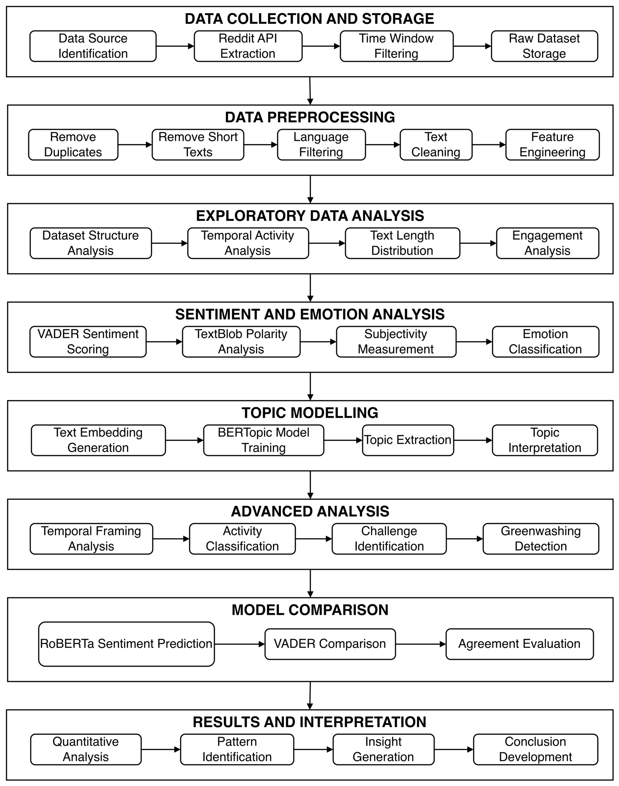

1. **Collect.** Posts and comments gathered with PRAW from the new, hot, top and rising feeds (up to 3,000 posts scanned, up to 100 comments per post). Texts under 20 characters and duplicates removed; usernames and subreddit references anonymised with regular expressions.
2. **Clean.** URLs, emojis, markdown and extra whitespace removed; encoding repaired with `ftfy`; contractions expanded; English (and undetectable short texts) kept using `langdetect`; Unix timestamps converted and a monthly variable added.
3. **Score.** VADER compound, positive, negative and neutral scores; TextBlob polarity and subjectivity.
4. **Emotion.** A keyword lexicon covering anger, joy, fear, trust, anticipation, sadness, surprise and disgust, with normalised scores to find the dominant emotion.
5. **Discover.** BERTopic clustering on `all-MiniLM-L6-v2` sentence embeddings, with topics labelled from their keywords.
6. **Classify.** Texts tagged by sustainability activity (transport, energy, food and others) and by challenge type.
7. **Cross-check.** A RoBERTa sentiment model run in batches and compared with VADER.

## Results

**Overall tone is mildly positive but critical.** Mean VADER compound score is 0.160. Actionable, everyday topics read positively (water use and shower habits: +0.413), while systemic topics read negatively (recycling and plastic waste: −0.260).

**What people talk about doing.** Transport dominates (43.03%), followed by energy use (19.50%) and food (15.98%).

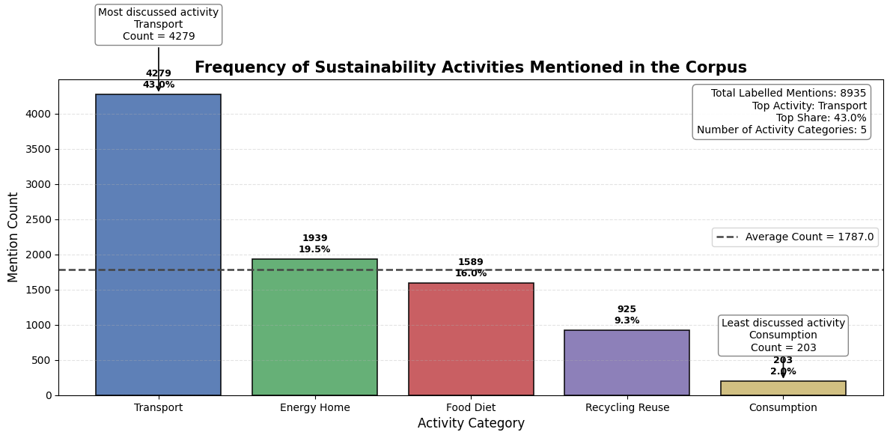

**What holds them back.** Policy and political barriers (10.15%), cost and accessibility (8.34%), and the systemic-versus-individual responsibility debate (5.87%).

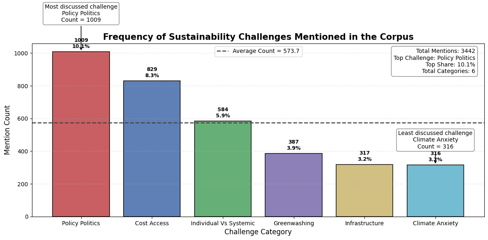

**Topics.** Among defined topics the most discussed are greenwashing (2.4%), animal agriculture (1.7%), climate debates (1.7%) and energy (1.5%). 17.6% of records fall in BERTopic's outlier topic.

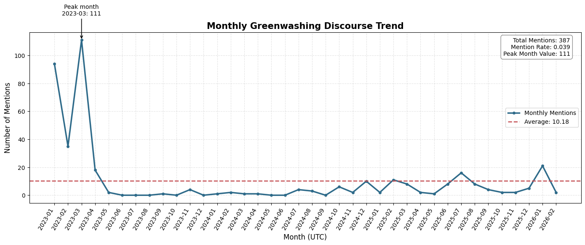

**The tool changes the answer.** RoBERTa labels 4,551 texts negative, 3,809 neutral and 1,583 positive, a far more negative picture than VADER. The two models agree on only 44.4% of texts, and VADER-positive texts are often neutral or negative to RoBERTa. Conclusions about online sentiment should not rest on a single lexicon tool.

<p>
  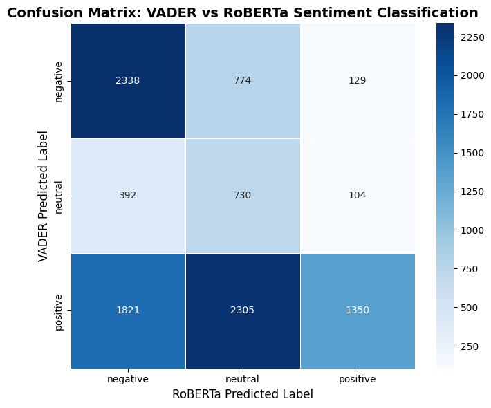
  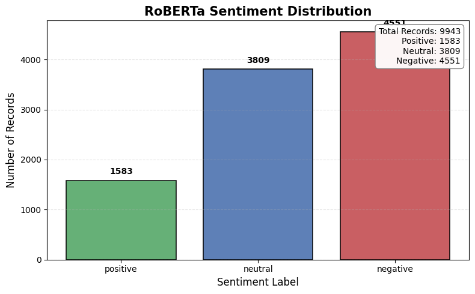
</p>

<details>
<summary><b>More figures</b></summary>

| | |
|---|---|
| 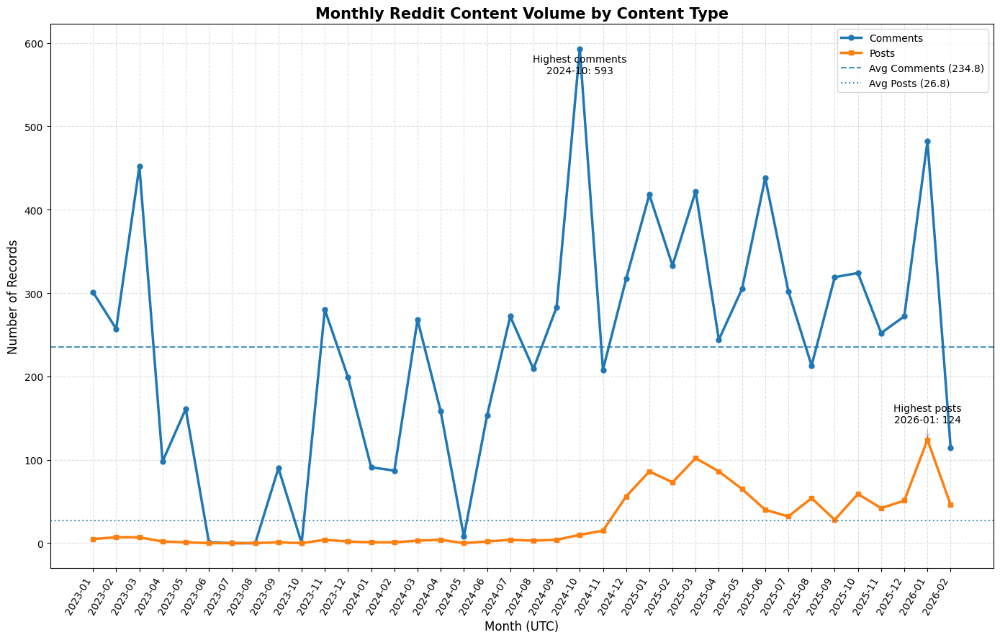 | 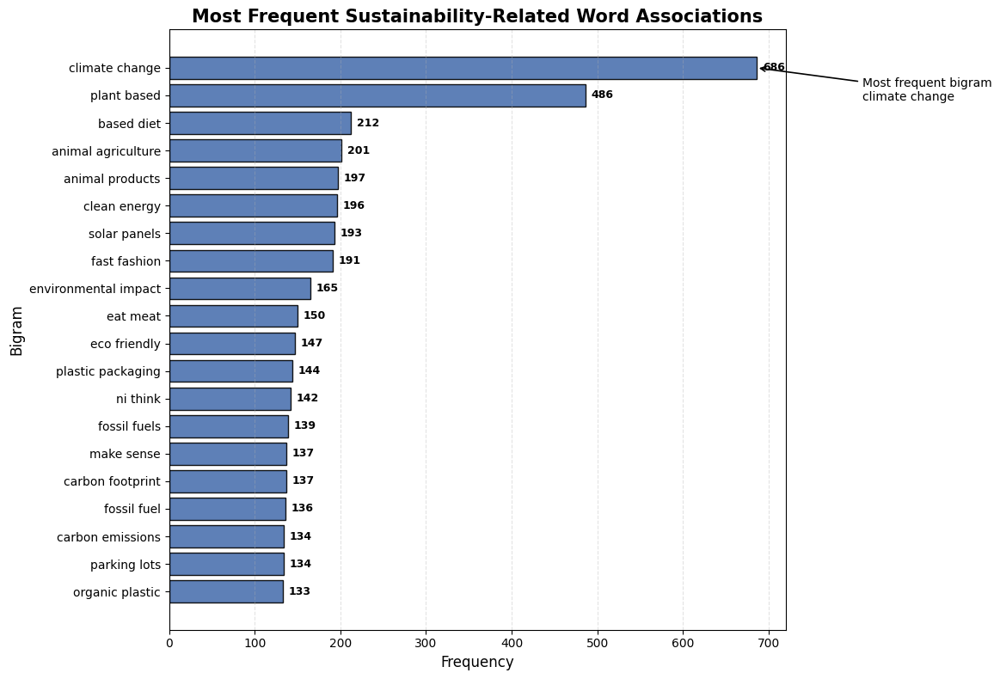 |
| 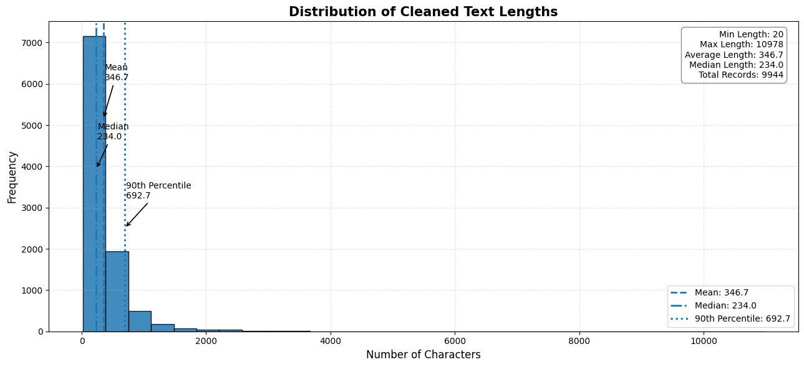 | 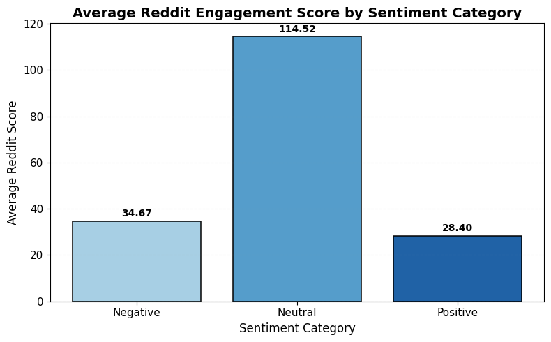 |
| 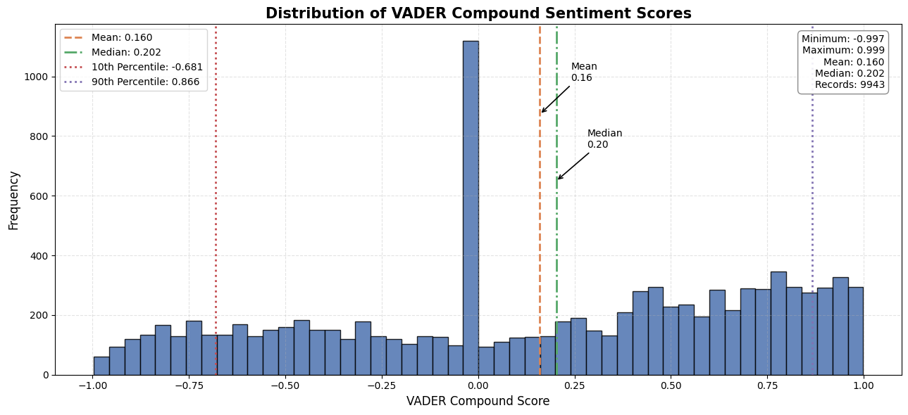 | 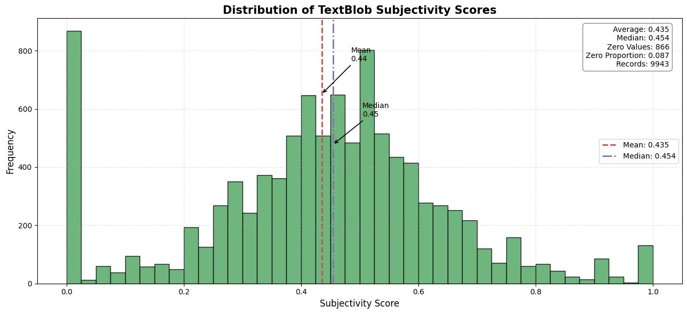 |
| 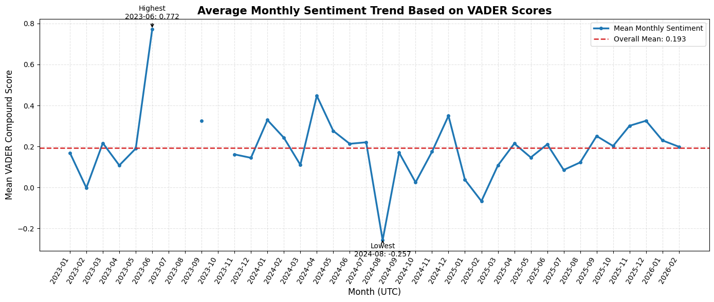 | 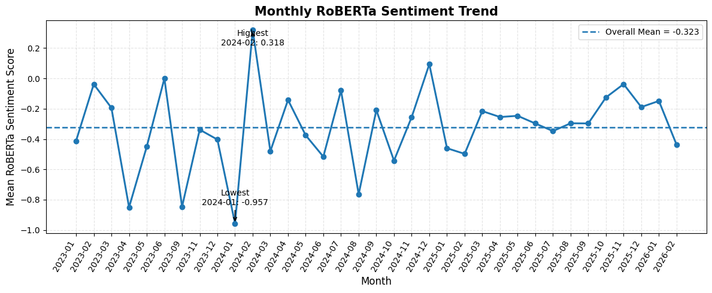 |

</details>

## Limitations

- One community on one platform, so findings describe r/sustainability rather than public opinion in general.
- Emotion detection uses a keyword lexicon, which cannot read sarcasm, negation or context. Emotion percentages should be read as indicative.
- Sentiment models were used off the shelf, not fine-tuned on environmental text, and they disagree substantially with each other.

## Future work

- Extend to more platforms (for example X/Twitter and news comments) to improve generalisability.
- Fine-tune sentiment and emotion models on domain-specific environmental text.
- Add multimodal data (images and video) and time-series forecasting of discourse trends.
- Link online discussion to real environmental indicators.

## Running the code

The full analysis is in [`notebooks/reddit_sustainability_nlp.ipynb`](notebooks/reddit_sustainability_nlp.ipynb), in six sections: setup, data collection, cleaning and EDA, NLP analysis, evaluation, and RoBERTa sentiment.

**In Google Colab (easiest).** Click the *Open in Colab* badge above, switch to a GPU runtime, and run all cells. Project files are saved to `MyDrive/reddit-sustainability-nlp`.

**Locally.**

```bash
git clone https://github.com/rajaghalib/reddit-sustainability-nlp.git
cd reddit-sustainability-nlp
python -m venv .venv && source .venv/bin/activate
pip install -r requirements.txt
jupyter notebook notebooks/reddit_sustainability_nlp.ipynb
```

Files are written to `./project` by default; set the `PROJECT_DIR` environment variable to change this.

**Reddit API credentials.** Create a *script* app at [reddit.com/prefs/apps](https://www.reddit.com/prefs/apps). The notebook asks for the client ID, secret and user agent at run time with `getpass`, so no credentials are ever stored in the code.

The transformer step uses [`cardiffnlp/twitter-roberta-base-sentiment-latest`](https://huggingface.co/cardiffnlp/twitter-roberta-base-sentiment-latest).

## Data and privacy

Raw Reddit data is not included in this repository, and notebook outputs that displayed individual Reddit posts or comments have been removed. Usernames and subreddit mentions are anonymised during collection. Charts and aggregate outputs are kept.

## Repository structure

```
.
├── README.md
├── LICENSE
├── CITATION.cff
├── requirements.txt
├── assets/                               # social preview image
├── notebooks/
│   └── reddit_sustainability_nlp.ipynb   # full pipeline, with chart outputs
└── figures/                              # charts from the dissertation
```

## Citation

If this work is useful to you, please cite it. GitHub's **Cite this repository** button (right-hand sidebar) gives APA and BibTeX formats from [`CITATION.cff`](CITATION.cff).

```bibtex
@mastersthesis{khan2026reddit,
  author = {Khan, Raja Ghalib Hussain},
  title  = {Understanding Reddit Community Views on Sustainability Discourse through Multi-Technique NLP Analysis},
  school = {University of Hull},
  year   = {2026},
  type   = {MSc dissertation},
  url    = {https://github.com/rajaghalib/reddit-sustainability-nlp}
}
```

The code is archived on Zenodo with DOI [10.5281/zenodo.24451524](https://doi.org/10.5281/zenodo.24451524) (all versions).

## License

Code is released under the [MIT License](LICENSE).

## Author

**Raja Ghalib Hussain Khan**, AI & Software Engineer
[rajaghalib.co.uk](https://rajaghalib.co.uk) · [LinkedIn](https://www.linkedin.com/in/rajaghalib/) · [engr.rajaghalib@gmail.com](mailto:engr.rajaghalib@gmail.com)

Open to AI and data science roles, paid research positions and fully funded PhD opportunities.
